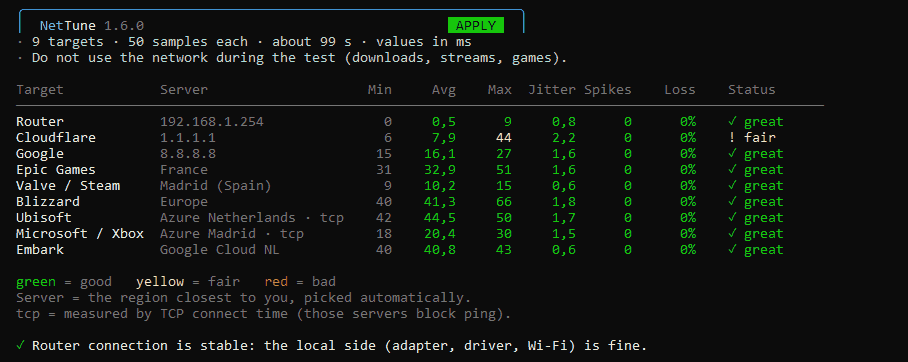

# NetTune

PowerShell script for Windows 10/11 that **measures** your connection, applies the tweaks that help latency and stability (plus the usual TCP Optimizer set, with an honest note on what each one really does), and measures again to show the difference. It saves a backup before changing anything, so you can always undo it.

It started from a real case: a laptop with a **MediaTek MT7925 (Wi-Fi 7)** card had 700 ms spikes in Fortnite. The culprits were the card's power saving and roaming. After the tweaks, the ping to the router went from a **144 ms average to 3 ms**.

## Screenshots

**Connection test** (ping, jitter, spikes and loss to the router, DNS and game servers):



**DNS test** (switches only when another public DNS clearly wins):


## What it does

Every change is read back after it is applied: `✓` when it stuck, `✗` when it did not, `!` when this Windows build or driver keeps it read-only (the script reports it and goes on). Everything goes into the backup, including values and keys that did **not** exist before, so Revert deletes them instead of writing a value.

The **Real effect** column is the honest part:

- **Games** = affects in-game ping or stability (games use UDP).
- **TCP only** = downloads, sites, launchers, stores. Not in-game ping.
- **None** = no measurable effect on latency. Included for parity with TCP Optimizer, or it just keeps the Windows default.

### Latency tweaks (always applied)

| Tweak | Value | What it does | Real effect |
|---|---|---|---|
| Power plan: Wi-Fi "Power Saving Mode" | Maximum performance | On battery, Windows puts Wi-Fi in medium power saving by default | **Games** |
| "Allow the computer to turn off this device" | off (`PnPCapabilities = 24`) | Windows stops putting the adapter to sleep. Takes effect after a restart | **Games** |
| Adapter power saving (`PowerSavingMode`, `LowPowerEnable`...) | off | The adapter sleeps between packets and is slow to wake up: spikes | **Games** |
| Roaming aggressiveness (`RoamAggressiveness`, `RoamNeedIndicateTh`...) | lowest / off | No scanning for other access points mid-game (each scan freezes the connection) | **Games** |
| Energy-Efficient / Green Ethernet (`*EEE`, `AdvancedEEE`...) | off | Same problem as power saving, on the cable | **Games** |
| USB selective suspend (`*SelectiveSuspend`) | off | For USB Ethernet adapters | **Games** |
| DNS | the best public one, only if clearly better | See [DNS test](#dns-test) | None for ping, faster lookups |
| MTU | the largest that works on your network | See [MTU test](#mtu-test). Only changed when the network cannot carry 1500 | **Games** only if it was wrong (fragmentation / drops) |

Driver options are found by **RegistryKeyword**, not by name, because the name changes with the Windows language. "Off" is value `0` in all of them.

### TCP Optimizer-style tweaks (skip with `-NoTcp`)

TCP globals (template `Internet`, `Set-NetTCPSetting` first, `netsh` as a fallback). Congestion provider (CUBIC), ECN and MinRto are left alone. MinRto is read-only on Windows 10/11. Chimney, NetDMA and DCA are obsolete and give errors on Windows 11, so they are not included.

| Tweak | Value | What it does | Real effect |
|---|---|---|---|
| Scaling heuristics | disabled | Stops Windows from shrinking the receive window by itself. Set before auto-tuning | TCP only |
| Receive window auto-tuning | normal | Lets the TCP receive window grow (the Windows default) | TCP only |
| Timestamps | disabled | 12 bytes less per TCP packet | TCP only, tiny |
| Initial RTO | 2000 ms | How long a new TCP connection waits before resending a lost SYN | None (parity) |
| Max SYN retransmissions | 2 | Gives up on a dead server sooner | None (parity) |
| Non-SACK RTT resiliency | disabled | Recovery behaviour for old TCP stacks without SACK | None (parity) |
| RSS (global and per adapter) | on | Spreads received packets over several CPU cores | Indirect: CPU load on fast wired NICs |
| RSC (global and per adapter) | off | Merges received TCP segments to save CPU | TCP only |
| Packet coalescing | off | Lets the adapter hold broadcast / multicast packets in low power | None to tiny (not game unicast) |
| Checksum offload | on (only if it was off) | Lets the adapter compute checksums | None (keeps the default, saves CPU) |
| LSO (Large Send Offload) | off | The adapter splits big TCP sends; off avoids bursts on upload | TCP only |

Registry (HKLM, takes effect **after a restart**):

| Tweak | Value | What it does | Real effect |
|---|---|---|---|
| `Tcpip\Parameters` `DefaultTTL` | 64 | Starting TTL of outgoing packets (Windows default is 128) | None (parity) |
| `Tcpip\Parameters` `MaxUserPort` | 65534 | Legacy limit on outgoing ports. Windows 10/11 sets the port range elsewhere | None (parity) |
| `Tcpip\Parameters` `TcpTimedWaitDelay` | 30 | Frees closed TCP ports sooner | TCP only |
| Nagle: `Interfaces\{adapter}` `TcpAckFrequency` / `TCPNoDelay` / `TcpDelAckTicks` | 1 / 1 / 0 | ACKs every TCP packet right away instead of waiting. Set on every physical adapter, connected or not. On Wi-Fi, also kept on every network change (see below) | TCP only: a few older TCP-based games. Most games use UDP |
| MMCSS `NetworkThrottlingIndex` | `0xffffffff` | Turns off the throttling of non-media packets while audio or video is playing | Small, only while media plays |
| MMCSS `SystemResponsiveness` | 10 | CPU share reserved for background tasks. **10, not 0**: Microsoft documents that below 10 Windows uses 20 | None for the network |
| `ServiceProvider` `LocalPriority` / `HostsPriority` / `DnsPriority` / `NetbtPriority` | 4 / 5 / 6 / 7 | Order of name resolution (local, hosts file, DNS, NetBIOS) | None in-game (lookups only) |
| `Policies\...\Psched` `NonBestEffortLimit` | 0 | Bandwidth reserved for QoS traffic (the "20% reserved" myth: nothing is reserved without QoS apps) | None (parity) |
| `Tcpip\QoS` `Do not use NLA` | "1" | Lets QoS policies apply outside a domain network | None unless you use QoS policies |
| IE `FEATURE_MAXCONNECTIONSPER1_0SERVER` / `...PERSERVER` (`explorer.exe`, `iexplore.exe`) | 10 | More parallel connections per server for legacy WinINet apps | None (parity) |
| `Memory Management` `LargeSystemCache` | 0 | Desktop file cache behaviour (0 is the client default, recommended for gaming). If it is 1, it goes back to 0 | None for the network |

#### Nagle on Wi-Fi: why a scheduled task

On Wi-Fi, the adapter's `Interfaces\{GUID}` key holds the TCP/IP settings of **the network you are connected to**. Windows also keeps a subkey per network it has seen (named after the SSID in hex), and **rebuilds the main key when you connect to another network**, wiping any value it does not know, like the Nagle ones. A reconnect to the same network keeps them; a different network does not. Ethernet has no per-network keys, so the values stay there.

So on Wi-Fi, Apply:

1. writes the Nagle values on the main key **and** on every network subkey;
2. registers a small scheduled task, `\NetTune\NetTune Nagle keeper`. It runs as SYSTEM with no window, 10 s after every "network connected" event (and at startup), and writes the three values again on the main key and every subkey.

Both are in the backup. Revert removes the task and deletes the values, including the ones the task wrote later for networks that did not exist at Apply time. Without admin rights, Test cannot see a SYSTEM task, so it shows "not found (or readable as admin only)" and does not count it.

## What it does NOT do (on purpose)

- **Promise that the TCP tweaks lower in-game ping**: games use UDP. They are there because people ask for the TCP Optimizer set; the table above says what each one really changes. Use `-NoTcp` to skip them.
- **Chimney, NetDMA, DCA**: obsolete, and they give errors on Windows 11.
- **Promise that DNS lowers ping**: DNS only turns names into IPs before connecting. It plays no part during the match. Changing DNS can make sites open faster, but it does not touch ping.
- **Touch VPNs, virtual adapters or Bluetooth**: they are ignored.

## How to use

Open **PowerShell as administrator** (the blue one, Windows PowerShell 5.1) in the script's folder.

```powershell
# 1. Only measure and see the adapter state (changes nothing, no admin needed)
powershell -ExecutionPolicy Bypass -File .\NetTune.ps1

# 2. Dry run: shows what would be changed, without changing anything (works without admin too)
powershell -ExecutionPolicy Bypass -File .\NetTune.ps1 -Mode Apply -WhatIf

# 3. Apply (measures before, backs up, applies, measures after and compares)
powershell -ExecutionPolicy Bypass -File .\NetTune.ps1 -Mode Apply

# 3b. Apply without touching DNS
powershell -ExecutionPolicy Bypass -File .\NetTune.ps1 -Mode Apply -Dns Keep

# 3c. Apply and force Cloudflare DNS (without testing the others)
powershell -ExecutionPolicy Bypass -File .\NetTune.ps1 -Mode Apply -Dns Cloudflare

# 4. Undo everything (uses the most recent backup)
powershell -ExecutionPolicy Bypass -File .\NetTune.ps1 -Mode Revert
```

Other options:

- `-Count 100`: more pings per target (default is 50).
- `-Services Epic,Valve`: tests only some game services (options: `Epic`, `Valve`, `Blizzard`, `Ubisoft`, `Microsoft`, `Embark`; all by default).
- `-ExtraTargets 1.2.3.4`: adds your own server to the test (another game's IP, for example).
- `-SkipTest`: applies without running the before and after tests.
- `-NoTcp`: skips the TCP Optimizer-style tweaks (TCP globals, offloads, registry, Nagle).
- `-NoMtu`: skips the MTU test (and setting the MTU).
- `-BackupFile .\backups\backup-XXXX.json`: picks a specific backup for Revert.
- `-Ascii`: uses only ASCII characters on screen, if your console shows boxes instead of `✓ ─ ╭`. Not needed in Windows Terminal (the Windows 11 default).

Full help: `Get-Help .\NetTune.ps1 -Full`.

During Apply, the connection drops for a few seconds while the adapters restart. Every adapter that needs it restarts **once**, all together, at the end (RSC, RSS, checksum, LSO and driver options are all applied with `-NoRestart` first).

**Restart the PC after Apply (and after Revert).** The registry values (Nagle, MMCSS, Tcpip, ServiceProvider) and the "allow the computer to turn off this device" option only take effect after a restart, so the script's "after" test does not include them yet. Restart and run `-Mode Test` to see the full effect. At the end, Apply asks `Restart now? (y/N)`; Enter means no. It never asks with `-WhatIf`.

### After the restart: it carries on by itself

If you answer **y** to `Restart now?`, Apply first:

1. saves `logs\pending-after-restart.json` with the "before" test results, the servers it used, the backup file, the date and time, and the network: adapter, network profile name (`Get-NetConnectionProfile`) and gateway IP;
2. registers a **one-time** scheduled task, `\NetTune\NetTune after restart`: at **your** next logon, highest rights (no UAC prompt), interactive (the window shows up), also on battery. It runs `powershell.exe -NoExit -ExecutionPolicy Bypass -File "...\NetTune.ps1" -Mode Test -AfterRestart` from the script's folder;
3. restarts.

When you log in, NetTune opens by itself and:

- **deletes the scheduled task first**, so it runs only once even if something fails;
- waits for the network (the router answering, up to 2 minutes);
- counts down **90 s** so the programs that start with Windows settle down. **Press any key to start right away**;
- checks that it is **the same network** as Apply. If not, it warns in a red box that the comparison is not valid, and tests anyway;
- shows **CURRENT STATE**, to confirm everything is `✓`, runs the full connection test on the same servers, and shows **Before vs after** against the saved "before". This one **does** include the registry values;
- deletes `pending-after-restart.json`.

If you did not restart (the task or the file is older than 24 h), the next normal run of NetTune removes both without running anything. Revert removes them too. With `-WhatIf` nothing is scheduled; the simulation only says what would happen.

### How power management works

`Set-NetAdapterPowerManagement` has no parameter for this option, so the script writes to the registry directly. It is the same as unticking the box in Device Manager:

- Key: `HKLM\SYSTEM\CurrentControlSet\Control\Class\{4d36e972-e325-11ce-bfc1-08002be10318}\00XX`, the subkey whose `NetCfgInstanceId` is the adapter's GUID.
- Value: `PnPCapabilities` (DWORD) = `24`.
- The backup stores the old value, or that it was not set. Revert restores that value or deletes the entry.

## Reading the screen

**Current state.** The TCP globals, offloads and registry values are shown first (also in Test mode), then each adapter with its options, MTU, offloads and Nagle values. Offloads the driver does not let Windows change are shown as "fixed by the driver", and Apply does not try them.

- Green `✓`: already optimized.
- Yellow `!`: Apply will change this (the new value appears after the `→`).

In Test mode, the summary at the end says how many tweaks are left.

**Connection test.** Measures the **router**, **Cloudflare** and **Google**, plus one server per game service (see below). Rows appear as each target finishes, with a progress bar. Each value is colored **green** (good), **yellow** (fair) or **red** (bad). The *Status* column gives the row's verdict: the worst of its values.

| Column | What it is | Green | Yellow |
|---|---|---|---|
| Server | The region measured. For games, the one closest to you, picked automatically | | |
| Avg | Average ping | Router ≤ 5 ms · Cloudflare/Google ≤ 40 · games ≤ 60 | Router ≤ 15 · ≤ 80 · ≤ 100 |
| Max | Worst ping | Up to 30 ms above the minimum | Up to 100 ms above |
| Jitter | How much the ping varies from one packet to the next | ≤ 5 ms | ≤ 15 ms |
| Spikes | Pings 100 ms or more above the minimum | 0 | 1-2 |
| Loss | Lost packets | 0% | ≤ 2% |

With few pings (for example `-Count 5`), a single lost packet is already 20% and the row turns red. For a proper diagnosis use the default of 50.

**Before vs after** (in Apply). Shows the average, jitter and loss with a green `▼` when it improved, a red `▲` when it got worse and `=` when it stayed the same. If Apply changed nothing, the "after" test and this table are skipped.

**The golden rule:** if the ping to the **router** is high or has spikes, the problem is your PC, the Wi-Fi or the router, not your ISP or the game. The router is right next to you; 1-5 ms is normal.

- If some adapter settings are still unoptimized, the script points at the adapter / driver (Apply fixes those).
- If they are **all already optimized**, the spikes come from the Wi-Fi or the router itself (interference, other devices using the network, a stuck router). The script suggests testing with a cable, closing background downloads and restarting the router (30 s unplugged from power).
- If the router spikes come back **at regular intervals**, the script says so and recommends restarting the router. With the default 50 pings it catches repeats every 2-4 s; use `-Count 200` to catch slower ones.

## DNS test

By default (`-Dns Auto`), Test and Apply modes test **Cloudflare**, **Google**, **Quad9** and **OpenDNS**, and also show the DNS you are using as a reference. The current DNS is the one of the adapter actually carrying traffic to the internet, the route Windows itself picks; a disconnected adapter with an old route does not count.

- **How it measures:** the script sends DNS queries straight to each server (UDP, port 53), bypassing the Windows cache. 10 domains you use while gaming (Epic, Steam, Battle.net, Ubisoft, Xbox, Discord, Twitch...) × 3 rounds, plus 5 random names that force the server to ask the domain itself. Servers are interleaved, so they all get the same network conditions.
- **Columns:** *Median* is the usual response time (cached), *Uncached* is the first time a name is requested, *Fails* are the queries with no answer. The chosen one gets a `★`.
- **The router does not count.** If your DNS is the router (for example `192.168.1.254`) or another local network IP, it only forwards to your ISP's DNS. It answers in ~1 ms because it caches on the local network, but that is not comparable with a real DNS. It appears in the table only as a reference ("local cache, ignored").
- **How it chooses:** score = 70% median + 30% uncached, only among public DNS servers with up to 10% failures. Differences up to **5 ms (or 20%)** count as a tie, because the same server varies that much between runs. On a tie it prefers **Cloudflare**, then Google (Quad9 and OpenDNS filter domains).
- **When it switches:** if your DNS is the router or your ISP's, it switches to the chosen one. If you already use a public DNS, it only switches if the other one is better by more than the tie margin.
- **How it applies:** on each adapter, **IPv4 and IPv6 separately**, set by hand (`netsh`, by adapter index). Then it reads each family back and only shows `✓` if it was really applied. If IPv6 is disabled on the adapter, it only sets IPv4.
- **IPv4 already Cloudflare, IPv6 not:** when you keep Cloudflare but the IPv6 DNS is still automatic (router / ISP), Apply also sets the Cloudflare IPv6 (`2606:4700:4700::1111`, `2606:4700:4700::1001`) on the adapters whose IPv4 is Cloudflare, with the same backup and Revert.
- **Backup and Revert:** the old DNS of each family is stored in the backup. A static DNS is read from `NameServer` or, on Wi-Fi, from `ProfileNameServer` (Wi-Fi keeps a static DNS per network), so Revert puts back a static DNS instead of switching to automatic.
- **Limitation on Wi-Fi:** Wi-Fi keeps the DNS **per network**, so Revert only restores the DNS of the network you are connected to when you run it. If you applied on one Wi-Fi and revert on another, the first one keeps the DNS that Apply set until you connect to it again and run Revert there. Ethernet has no per-network settings, so this does not apply to it. Revert restores each one (the old static list, or automatic/DHCP if there was none).
- **Networks that block external DNS** (schools, offices, some public networks): the public DNS servers show up as "no response" and the script **changes nothing**, because changing would cut your internet. With `-Dns Cloudflare` (forced), the script first checks that DNS answers. If it does not, it refuses.
- **Honesty:** DNS only speeds up opening sites and connecting to services (login, stores, matchmaking). **It does not change in-game ping.**

Options: `-Dns Auto` (default), `-Dns Keep` (does not test or touch DNS), `-Dns Cloudflare | Google | Quad9 | OpenDNS` (forces that one, after checking it answers).

## MTU test

The MTU is the largest packet your connection carries in one piece. If Windows uses a bigger one than the network supports (common with PPPoE fibre, some 4G/5G routers and tunnels), big packets get fragmented or silently dropped. TCP Optimizer's "Largest MTU" guesses with `ping -f -l`; NetTune measures it properly:

1. **Only the adapter carrying the internet** (the default route Windows actually uses).
2. **If its MTU is below 1500, it is raised to 1500 for the test only** (Apply mode, saved in the backup). Otherwise Windows itself blocks the bigger packets and the test could never find more than the current MTU. In Test mode the MTU is never touched, so the test only goes up to the current value.
3. **Real "Don't Fragment" pings** (`System.Net.NetworkInformation.Ping` with `DontFragment`). The script does not read `ping.exe` text, which is in the Windows language. *PacketTooBig* = too big, *Success* = fits, *TimedOut* = tried up to 3 times before deciding.
4. **Binary search** of the payload between 1172 and 1472 bytes (MTU 1200-1500) to **1.1.1.1, 8.8.8.8 and 9.9.9.9**.
5. **Confirmed**: the size found must pass 5 out of 5 pings and one byte more must always fail. If small pings pass but big ones always time out (a network that drops instead of answering "too big"), that counts as too big, and the output says so.
6. **MTU = the smallest result + 28** (20 bytes IP header + 8 ICMP). If ICMP is blocked (even small pings fail), the MTU is left as is and the script says why.
7. **1500 → nothing to do** ("MTU 1500 is already the maximum on this network"). Lower → Apply sets it with `netsh interface ipv4/ipv6 set subinterface "<adapter>" mtu=X store=persistent` (IPv6 minimum 1280). The test always puts the MTU back as it was, also if it fails halfway, and Revert restores the old IPv4 and IPv6 values.

**The MTU depends on the network**: run it again when you change networks (another Wi-Fi, a hotspot, a VPN).

## Game servers

For each service, the script first runs a quick test on every region (in parallel), keeps the one closest to you and only then measures it properly. In Apply, the "after" test uses the same servers as "before", so the comparison is fair.

| Service | What is measured | Regions | How close to the real game |
|---|---|---|---|
| **Epic Games** | Official Fortnite ping beacons | France, Germany, United Kingdom, US (East, Central, West), Brazil | The game's own ping servers |
| **Valve / Steam** | Valve SDR relays (CS2, Dota 2, Deadlock…). The list comes live from the Steam API, with a built-in fallback list | Every Valve datacenter worldwide | Game traffic goes through these relays |
| **Blizzard** | Battle.net servers | Europe, US, Korea | Blizzard infrastructure (on Google Cloud) |
| **Ubisoft** | Azure regions used by Rainbow Six, plus AWS (GameLift) | Azure Ireland, Netherlands, US ×4, Brazil · AWS Frankfurt, US East | The datacenters where the servers run, not the server itself |
| **Microsoft / Xbox** | Azure regions | 15 regions, from Europe to Asia and Australia | The datacenters, not the server itself |
| **Embark** | The Finals / Arc Raiders run on Google Cloud, but Embark has no public ping endpoints. The Google Cloud region is measured instead | Google Cloud Netherlands, US, Korea | Rough reference |

Notes:

- **`tcp` in the Server column:** Azure blocks ping, so on those servers the TCP connect time (port 443) is measured. A TCP handshake takes almost exactly one round trip, so the numbers are comparable with ping.
- **It is a reference, not the exact in-game ping.** In-game ping depends on the specific match server. But if the closest region already shows spikes or loss here, the game will too.
- **Riot (Valorant, LoL)** is left out: their public ping IPs no longer respond.
- For another game, add its server IP with `-ExtraTargets`.

## Files

- `backups/backup-<date>.json`: the original state of every changed option: each adapter's old `PnPCapabilities`, offloads, driver options and DNS, the Wi-Fi power plan, the TCP globals, every registry value (or that it, or its key, did not exist) and the old MTU.
- `logs/nettune-<mode>-<date>.log`: the full log of every run.
- `logs/pending-after-restart.json`: only between an Apply with "Restart now? y" and the test after the restart (see above).
- Scheduled tasks in the Task Scheduler folder `NetTune`: `NetTune Nagle keeper` (Wi-Fi only, until Revert) and `NetTune after restart` (one time).

Both folders are in `.gitignore`, because they are specific to each PC.

## Notes

- An adapter driver update (Windows Update or Lenovo Vantage, for example) can restore the factory values. If the spikes come back, run `-Mode Apply` again.
- If you get an execution policy error, always use `powershell -ExecutionPolicy Bypass -File ...` as in the examples.
- Built for PowerShell 5.1 (the one that ships with Windows). It also runs on PowerShell 7.

## Changelog

### 1.7.0

- **TCP Optimizer-style tweaks** (on by default in Apply, `-NoTcp` skips them): TCP globals (heuristics, auto-tuning, timestamps, initial RTO, SYN retransmissions, non-SACK RTT resiliency), offloads (RSS on, RSC off, packet coalescing off, checksum offload on, LSO off) and registry values (Tcpip, Nagle per adapter, MMCSS, ServiceProvider, Psched, QoS, IE max connections, LargeSystemCache). The README table says what each one really changes.
- **Automatic MTU test** (`-NoMtu` skips it): Don't Fragment pings with a binary search to 1.1.1.1, 8.8.8.8 and 9.9.9.9, a confirmation step, and handling for networks that block ICMP or drop big packets silently. It sets the MTU only when the network cannot carry 1500.
- **Every change is read back** and shown as `✓` / `✗`, or `!` when it is read-only on this Windows or driver.
- **Backup and Revert cover everything new**, including values and keys that did not exist (Revert deletes them).
- **Driver options are found by RegistryKeyword**, no longer by their (translated) name.
- **CURRENT STATE shows all the new values**, also in Test mode.
- **Adapters restart once**, all together, at the end of Apply.
- **End of Apply**: warns that the registry values need a restart and asks `Restart now? (y/N)` (not with `-WhatIf`).
- **Carries on by itself after the restart** (`-AfterRestart`): on "y", Apply saves the "before" test and schedules a one-time test at your next logon. That test waits for the network, counts down 90 s (any key skips it), warns if the network is different, shows CURRENT STATE and Before vs after including the registry values, then cleans up. Leftovers older than 24 h are removed; Revert removes them too.
- **Nagle on Wi-Fi survives network changes**: Windows rebuilds the Wi-Fi adapter's TCP/IP key when it connects to another network, which wiped the values. Apply now also writes them on every network subkey, and a SYSTEM task writes them again on every network connection. Both are in the backup and Revert.
- **Revert keeps a static DNS on Wi-Fi**: the backup only read `NameServer`, but on Wi-Fi a static DNS can live in `ProfileNameServer`. The backup read "empty" and Revert switched that adapter to automatic (DHCP). It now reads both.
- **Fixed**: Revert stopped halfway with "The property 'Bad' cannot be found" (a loop variable `$g` replaced the `$G` symbol table, since PowerShell names ignore case). The log was also never closed properly (`Stop-Transcript -WhatIf`).
- **Visible progress** in the region search and the MTU test: a status line shows each step, and the MTU rows appear as each target finishes.
- **`-WhatIf` no longer needs admin.**
- Includes the 1.6.1 fixes below.

### 1.6.1

- **Apply with nothing to change:** skips the "waiting for the network" step, the "after" test and the "Before vs after" table, and just says nothing was changed.
- **Clearer router diagnosis:** when the router is unstable but every adapter setting is already optimized, the script no longer blames the adapter or driver. It says the spikes come from the Wi-Fi or the router itself and suggests testing with a cable, closing background downloads and restarting the router (30 s unplugged).
- **Periodic spikes:** detects router spikes that repeat at regular intervals and recommends restarting the router.
- **Cloudflare IPv6:** if the IPv4 DNS is already Cloudflare but the IPv6 is not, Apply also sets the Cloudflare IPv6 servers on that adapter, with backup and Revert.

## License

MIT
